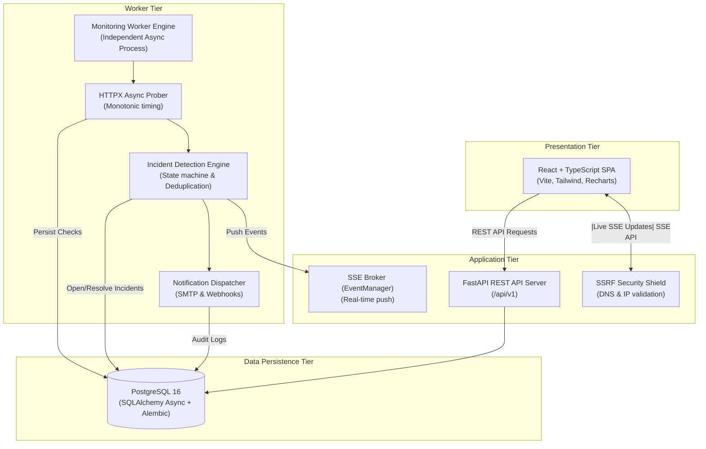

# PulseOps System Architecture

## Architecture Diagram

## Architectural Components

1. **Frontend (React 18 + TypeScript + Vite)**:
   - Modern dark-themed dashboard.
   - Real-time updates delivered through Server-Sent Events (SSE).
   - Dynamic latency percentile distribution charts ($P_{50}, P_{90}, P_{95}, P_{99}$).

2. **FastAPI REST Backend (`/api/v1`)**:
   - Asynchronous endpoints with Pydantic v2 validation.
   - JWT token authentication with bcrypt password hashing.
   - Comprehensive error handling and CORS support.

3. **Monitoring Worker (`app.workers.scheduler`)**:
   - Decoupled process running independently of browser sessions.
   - Concurrency bounded by async semaphores (`MAX_CONCURRENT_CHECKS`).
   - Monotonic microsecond clock for accurate latency metrics.

4. **Incident Engine (`app.services.incidents.detector`)**:
   - Evaluates consecutive probe failures to prevent flapping.
   - Incident deduplication (one active ticket per endpoint per issue).
   - Automated ticket recovery on consecutive verified successes.

